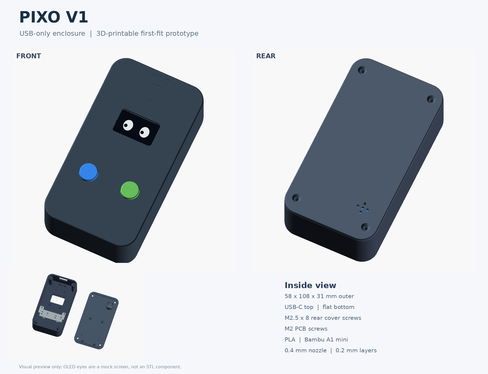
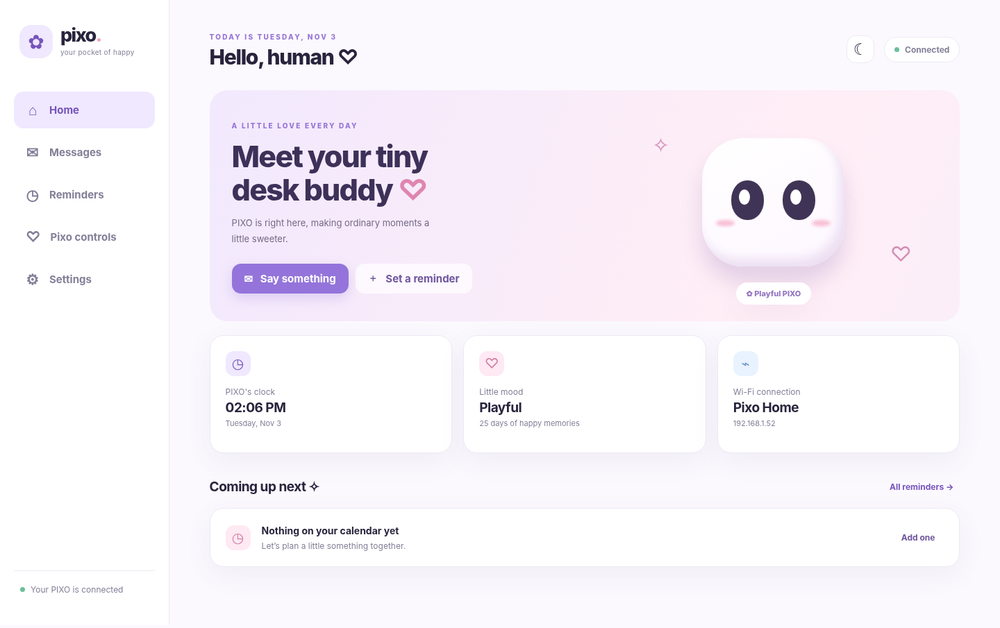
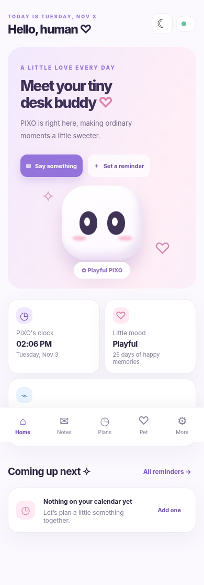

<div align="center">

# PIXO ♡
### A tiny digital pet with a big personality

**ESP32-powered desktop pet · Local Wi-Fi dashboard · OLED animations · Messages & reminders**

   

**Pet PIXO, send a little message, or set a reminder — right from your phone.**  
No paid cloud, mobile app installation, or external web host required.

[Getting started](#-getting-started) · [Hardware](#-hardware--wiring) · [Dashboard](#-web-dashboard) · [API](#-rest-api) · [Troubleshooting](#-troubleshooting)

</div>

---

## ✨ Meet PIXO

PIXO is a cute, interactive pet that lives on a **0.96-inch monochrome OLED**. It blinks, plays, gets sleepy, asks for snacks, remembers its birthday, and reacts when you pet it.

**PIXO V1 Smart Dashboard** adds a locally hosted companion interface so you can:

- 💌 **Send messages** that appear on PIXO's OLED with a notification animation.
- ⏰ **Schedule reminders** that can wake PIXO and be snoozed with a button.
- 💜 **Choose moods** such as happy, love, sleepy, and excited.
- 🌙 **Manage sound, Do Not Disturb, and animation pace.**
- 📡 **Set up Wi-Fi** without editing your SSID into the firmware.
- 🧸 **Keep PIXO's existing personality**, petting, feeding, secrets, wardrobe, calendar, weather, and saved memories.

This project integrates the dashboard with the earlier **PIXO Pet Life v6.1** firmware rather than replacing its pet engine.

## 📸 Digital Pet preview



## 📸 Dashboard preview

| Desktop | Mobile |
|:---:|:---:|
|  |  |

The dashboard uses soft pastel colors, animated PIXO eyes, rounded cards, responsive navigation, and light/dark styling. The web assets are bundled in the ESP32's firmware and render without an external CDN.

## 🧩 Hardware & wiring

**Target board:** ESP32 Dev Board, 30-pin, USB-C, CP2102, powered by USB (no battery).

| Part | ESP32 connection | Notes |
|---|---|---|
| 0.96-inch SSD1306 OLED | SDA → **GPIO25**, SCL → **GPIO26** | VCC → 3.3 V; GND → GND |
| TTP223 capacitive touch | OUT → **GPIO32** | VCC → 3.3 V; GND → GND |
| Button A | **GPIO18** ↔ push button ↔ GND | `INPUT_PULLUP` |
| Button B | **GPIO19** ↔ push button ↔ GND | `INPUT_PULLUP` |
| Passive piezo buzzer (low current) | **GPIO27** (+), GND (−) | Use a driver for higher-current modules |
| ESP32 | USB-C | Provides device power and serial programming |

> **Important:** GPIO numbers are *not* header pin numbers. Follow the silkscreen on your exact ESP32 board. For a four-leg tactile button, connect opposite electrical sides, not two pins permanently connected together. **Never apply 5 V to an ESP32 GPIO.**

See [docs/WIRING.md](docs/WIRING.md) for more detail.

## 🚀 Getting started

### 1. Install the Arduino tools

- [Arduino IDE 2.x](https://www.arduino.cc/en/software)
- **esp32 by Espressif Systems** from Boards Manager (Arduino-ESP32 **3.x** recommended)
- **Adafruit SSD1306**, **Adafruit GFX Library**, and **ArduinoJson 7.x** from Library Manager (install prompted dependencies such as Adafruit BusIO)

Built-in ESP32 libraries are used for Wi-Fi, WebServer, mDNS, Preferences, LittleFS, HTTPClient, and time synchronization.

### 2. Flash the firmware

1. Download or clone this repository.
2. Open **`PixoV1_Dashboard/PixoV1_Dashboard.ino`** in Arduino IDE. Keep `PixoWeb.h` and `PixoWebAssets.h` alongside the sketch.
3. Select **ESP32 Dev Module**, your USB serial port, and the flash capacity of your device.
4. Select a partition layout with enough app space **and** a filesystem partition. For a verified 4 MB board, a **Huge APP / No OTA** layout with a compatible FS partition is one possible starting point.
5. Upload and open Serial Monitor at **115200 baud**.

**Upgrading a pet with existing memories?** Do not enable *Erase All Flash*. Back up flash before repartitioning, since a partition-table change can still invalidate stored data.

### 3. Connect PIXO to Wi-Fi

On first boot PIXO starts a password-protected Wi-Fi setup network:

| | |
|---|---|
| Wi-Fi network | `Pixo-Setup` |
| Setup page | **http://192.168.4.1** |
| Setup Wi-Fi password | Randomly generated; shown on PIXO's OLED and Serial Monitor |
| Supported home network | **2.4 GHz Wi-Fi** |

1. Join `Pixo-Setup` from your phone or laptop.
2. Open **http://192.168.4.1** in a browser (not `https://`).
3. Choose your home Wi-Fi and enter its password.
4. Create a **separate dashboard password** (minimum 10 characters).
5. Allow PIXO to reconnect to your home Wi-Fi. Rejoin that same network on your phone or laptop.
6. Open **http://pixo.local** or use PIXO's actual IP address shown in its settings/Serial Monitor.
7. Sign in with username **`pixo`** and the dashboard password you set.

> `.local` requires mDNS support on your network. If it doesn't resolve, the **IP address is the reliable fallback**, for example `http://192.168.1.123`. The IP shown here is only an example, not a fixed address.

### 4. Start playing

Open the dashboard in your browser. Try sending **“Hii PIXO! ♡”**, set a reminder a minute ahead, and press **Button A** to dismiss it or **Button B** to snooze it.

## 💻 Web dashboard

| Area | What you can do |
|---|---|
| **Home** | View connection, mood, PIXO face, date/time, and next reminder |
| **Messages** | Send text, see recent deliveries, delete individual messages or clear history |
| **Reminders** | Create/edit/delete, enable/disable, and use once/daily/weekdays/weekly repeats |
| **PIXO Controls** | Trigger expressions, toggle sound and DND, adjust animation pace |
| **Settings** | View Wi-Fi and IP, choose device name/timezone, change Wi-Fi, restart |

### Messages 💌

- Messages arrive through the ESP32's **local HTTP API**, are stored in flash, and are queued for OLED display.
- Long text is shown in readable pages rather than flashed too quickly.
- A message can be dismissed with **Button A**, or it disappears after a display timeout.
- **Message history:** up to **20** recent messages, max **200 characters** each.

### Reminders ⏰

- Supports **Once**, **Daily**, **Weekdays**, and **Weekly** schedules.
- Up to **16** reminders, with titles (max **64** characters) and optional descriptions (max **140** characters).
- A due reminder interrupts the normal pet face and can play a buzzer notification.
- **Button A:** dismiss. **Button B:** snooze for **5 minutes**.
- The schedule and snooze state persist even after closing the browser and restarting PIXO.
- Default device timezone: **Asia/Kolkata (IST)**. Reminders are stored internally as UTC timestamps.

**Important reminder-sound note:** The original dashboard source plays a reminder tune on notification. **Continuous ringing until dismissal is an optional code change**, not guaranteed in this packaged baseline. If you have applied that enhancement locally, test that it also stops on web dismissal, snooze, DND, and sound OFF before documenting it as a completed feature.

## 🐾 Existing pet features preserved

The integrated sketch retains PIXO's existing features, including:

- Animated eyes, blinking, emotions, random reactions, and accessories
- TTP223 touch-to-pet reaction on GPIO32
- Hunger prompts, strawberry/juice/cake feeding, and affection tracking
- Sleep/wake animations and the existing buzzer patterns
- Birthday, aging, pet history, and secret unlocks
- Calendar, Bengaluru weather, auto-night-mode, and on-device menus

**On-device button behavior** is context-sensitive:

| Input | Standard action | During a notification |
|---|---|---|
| Touch sensor | Pet PIXO | Existing interaction priority applies |
| Button A (short) | Menu / Back | Dismiss |
| Button A (long) | Return to face | — |
| Button B (short) | Next / Feed when hungry | Snooze active reminder 5 min |
| Button B (long) | Select / Save | — |
| A + B | Secret Peekaboo / Midnight Ghost | — |

## 🔌 REST API

**Base URL:** `http://pixo.local` or `http://<device-ip>`, from the same trusted LAN. Most dashboard requests require HTTP Basic authentication (`pixo` + your chosen password). Mutating requests require `X-Pixo-Action: 1` and JSON writes require `Content-Type: application/json`.

| Method | Endpoint | Purpose |
|---|---|---|
| `GET` | `/api/status` | Device state and next reminder |
| `GET`, `POST`, `DELETE` | `/api/messages` | List, send, or clear all messages |
| `DELETE` | `/api/messages/{id}` | Delete one message |
| `GET`, `POST` | `/api/reminders` | List/create reminders |
| `PUT`, `DELETE` | `/api/reminders/{id}` | Edit/delete a reminder |
| `POST` | `/api/reminders/{id}/snooze` | Snooze ringing reminder |
| `POST` | `/api/reminders/{id}/dismiss` | Dismiss ringing reminder |
| `POST` | `/api/controls` | Mood, sound, DND, animation speed |
| `GET`, `PUT` | `/api/settings` | Read/update settings |
| `POST` | `/api/restart` | Restart PIXO |
| `POST` | `/api/wifi/reset` | Reset Wi-Fi and dashboard login |

**Example: send PIXO a message**

```bash
curl -u pixo:'YOUR_DASHBOARD_PASSWORD' \
  -H 'Content-Type: application/json' \
  -H 'X-Pixo-Action: 1' \
  -d '{"text":"Hii PIXO! Have a lovely day ♡"}' \
  http://pixo.local/api/messages
```

For exact JSON request/response fields and validation limits, see **[docs/API.md](docs/API.md)**. Avoid putting real passwords in public scripts or shell history.

## 📁 Repository structure

```text
.
├── README.md
├── PixoV1_Dashboard/
│   ├── PixoV1_Dashboard.ino      # Existing pet + dashboard integration
│   ├── PixoWeb.h                 # Wi-Fi, APIs, storage, reminders, notifications
│   ├── PixoWebAssets.h           # Generated compressed web assets
│   ├── tools/
│   │   └── embed_web.py          # Rebuild embedded HTML/CSS/JS
│   └── web/
│       ├── index.html
│       ├── app.css
│       ├── app.js
│       ├── setup.html
│       └── setup.js
└── docs/
    ├── API.md
    ├── WIRING.md
    ├── TEST_CHECKLIST.md
    ├── dashboard_preview_desktop.png
    └── dashboard_preview_mobile.png
```

### Editing the dashboard UI

Modify the files in `PixoV1_Dashboard/web/`, then regenerate the firmware-embedded compressed assets:

```bash
python3 PixoV1_Dashboard/tools/embed_web.py
```

Upload the rebuilt firmware. **No LittleFS upload is needed for the dashboard pages themselves**; LittleFS is used for persistent message and reminder records.

## 💾 Storage & timekeeping

- **Preferences / NVS `pixo`**: existing pet birthday, affection, wardrobe, secrets, and related data.
- **Preferences / NVS `pixoweb`**: new dashboard settings, Wi-Fi credentials, authentication verifier, and network setup data.
- **LittleFS**: message and reminder JSON records, with backup files and write safeguards.
- **NTP**: synchronizes the clock when internet access is available; PIXO keeps counting time while powered.
- **After power loss without internet**: schedules remain saved, but due reminders wait until a valid clock is available. No backup RTC is installed.

All required storage is internal to the ESP32 — **no memory card is required**.

## 🔐 Security

This is a **local-first prototype**, not an internet-exposed service.

- Setup uses a password-protected Wi-Fi AP and a user-selected dashboard password.
- Dashboard pages and APIs use HTTP Basic authentication and write-request checks.
- **Do not port-forward the ESP32 web server** or put it on untrusted/shared Wi-Fi.
- Standard ESP32 HTTP is **not HTTPS**; Basic credentials and messages are not encrypted in transit on the LAN.
- Wi-Fi secrets in regular NVS are not automatically encrypted at rest. For commercial deployments consider flash/NVS encryption, secure boot, and a secure local reverse proxy or another authenticated transport.
- Browser-based firmware update is intentionally disabled; update over **USB**.

## 🛠 Troubleshooting

| Problem | What to check |
|---|---|
| **“Failed to fetch” / dashboard cannot connect** | The browser must reach the *ESP32*, not a local HTML file or `localhost`. Use `http://<actual-device-IP>`, make sure the phone and PIXO are on the same LAN, and avoid HTTPS/mixed-content requests. |
| `pixo.local` doesn't open | Use the actual IP from PIXO's Settings/Serial Monitor; some routers and clients don't support mDNS reliably. |
| `Pixo-Setup` page won't load | Join `Pixo-Setup`, stay connected despite “no internet,” and open **http://192.168.4.1** directly. |
| Wi-Fi connection fails | Confirm **2.4 GHz** SSID/password, signal quality, and whether your router isolates Wi-Fi clients. |
| Browser shows 401 / login prompt | Username is `pixo`; password is the dashboard password set during provisioning, not the Wi-Fi password. |
| Reminders don't fire after restart | Check internet/NTP time synchronization and timezone. Without a valid clock, schedules wait. |
| OLED blank / no pet display | Confirm I²C wiring and OLED power, and check Serial Monitor at 115200 baud. |
| Buzzer too quiet | Verify it is a passive low-current piezo; frequency and drive circuitry affect loudness. Don't overdrive a GPIO. |
| Changes to `web/` don't appear | Run `embed_web.py`, recompile, and upload; refresh browser cache. |

If connection still fails, inspect the **Serial Monitor at 115200 baud** for the real IP and server startup output. More verification steps are in [docs/TEST_CHECKLIST.md](docs/TEST_CHECKLIST.md).

## 🧪 Project status

- ✅ Dashboard HTML/CSS/JS smoke-tested in desktop and mobile browser with mock API responses.
- ✅ Embedded asset generation and basic source checks performed.
- ⚠️ **Full Arduino compilation on the specific ESP32 board, real Wi-Fi provisioning, physical OLED/button/buzzer behavior, and extended offline reminder reliability still require hardware testing.**
- ⚠️ This is an **integrated prototype**, not a certified production or safety-critical reminder device.

See the [test checklist](docs/TEST_CHECKLIST.md) before treating reminders as dependable.

## 💜 Roadmap

- End-to-end ESP32 hardware and stability testing
- Optional repeating reminder alert until dismissal, with proper DND/snooze behavior
- Backup/restore for pet memories and schedules
- Optional RTC for accurate offline restarts
- Improved secure provisioning and firmware update path

## 📄 License

No open-source license has been selected yet. **Add a `LICENSE` file** if you intend to grant others permission to use, modify, or redistribute this project. Until then, ordinary copyright rules apply.

---

<div align="center">

**Made with tiny pixels and a lot of love. ♡**  
*PIXO is small. The personality isn't.*

</div>
